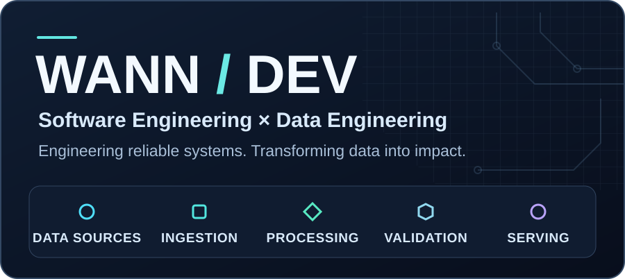
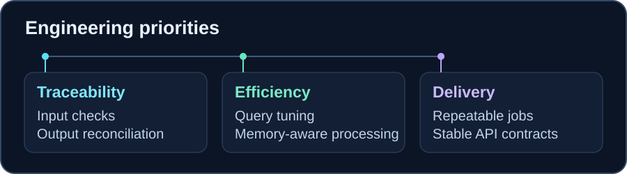
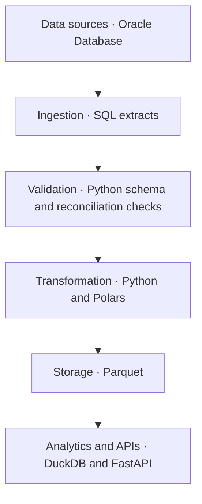
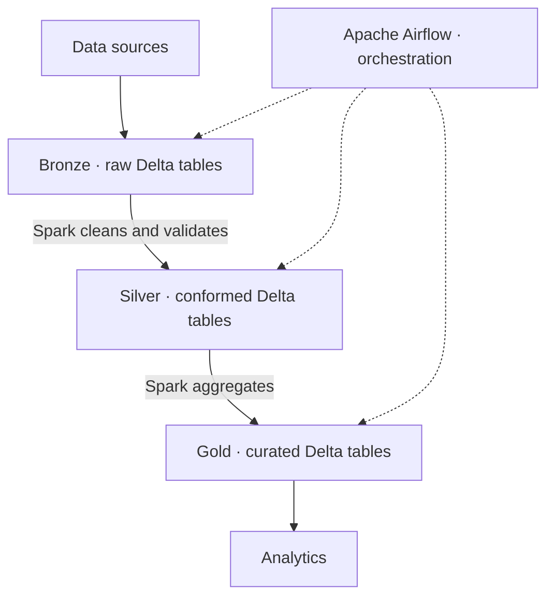

  <a href="https://github.com/Wannn-Dev">GitHub profile</a> ·
  <a href="https://github.com/Wannn-Dev/duckdb">DuckDB fork</a> ·
  <a href="https://github.com/Wannn-Dev/polars">Polars fork</a>

## About

I'm a Malaysia-based software engineer focused on data engineering, Python development and backend systems. My work spans data warehouse workflows, Oracle SQL extraction, SAS-to-Python modernization, batch reporting, data reconciliation and backend integrations. I focus on making large-file processing efficient and recurring workflows easy to run and verify.

## Engineering experience

| Focus | What I work on |
| --- | --- |
| Data pipeline modernization | Translate SAS and SQL extraction, transformation and reporting logic into maintainable Python workflows. |
| Performance engineering | Tune SQL queries and use memory-efficient processing for large files and datasets. |
| Data quality and reconciliation | Build validation utilities that compare outputs and surface discrepancies during migrations and batch runs. |
| Automation and backend engineering | Build repeatable batch jobs, report automation, backend utilities and API integrations. |

## Architecture

### Engineering data pipeline

An illustrative design for moving warehouse extracts through validation and transformation into analytical storage and APIs.

### Lakehouse architecture · currently learning

A learning reference for orchestration and medallion-layer design using Apache Airflow, Apache Spark and Delta Lake.

## Technology stack

| Experience | Area | Technologies |
| --- | --- | --- |
| Hands-on | Languages and data | Python, SQL, Oracle Database, SAS, Polars, DuckDB, Parquet |
| Hands-on | Backend and tooling | FastAPI, Git, GitHub, Linux, AWS fundamentals, Ruff |
| Currently learning | Distributed data and lakehouse | Apache Spark, Apache Airflow, Databricks, Delta Lake, lakehouse architecture, advanced distributed data processing |

## Open source

| Project | Upstream work | Status |
| --- | --- | --- |
| [DuckDB fork](https://github.com/Wannn-Dev/duckdb) | [Correct the default storage version in CLI help](https://github.com/duckdb/duckdb/pull/27666) and add CLI regression coverage | Submitted · open |
| [Polars fork](https://github.com/Wannn-Dev/polars) | [Fix the CSV output path in the getting-started guide](https://github.com/pola-rs/polars/pull/30088) | Submitted · open |
| [Polars fork](https://github.com/Wannn-Dev/polars) | [Handle additional NDJSON schema data types](https://github.com/pola-rs/polars/pull/30198) with Python regression tests | Closed without merge |

## Featured project

| Project | Purpose | Technical focus | Status |
| --- | --- | --- | --- |
| [BadmintonLah](https://github.com/Wannn-Dev/BadmintonLah) · private repository | Mobile-first platform for badminton tournament organizers and players | Next.js, FastAPI, PostgreSQL and Supabase Auth | MVP in development. Account flows and public tournament discovery are implemented. Registration, scheduling and scoring are planned. |

## Learning roadmap

| Focus | What I'm working through | Practice goal |
| --- | --- | --- |
| Apache Spark | DataFrame transformations, partitioning, shuffle optimization, execution plans and benchmarking | Compare execution plans and runtimes before and after a partitioning change. |
| Apache Airflow | DAG development, dependencies, scheduling, testing and idempotency | Build a testable batch DAG that can rerun a partition safely. |
| Databricks and Delta Lake | Bronze, Silver and Gold layers, Delta `MERGE`, time travel and pipeline reliability | Practice incremental updates and verify table state before and after a rerun. |

## GitHub activity

<picture>
  <source media="(prefers-color-scheme: dark)" srcset="https://github-readme-stats.vercel.app/api?username=Wannn-Dev&amp;theme=github_dark&amp;hide_rank=true" />
  
</picture>

<picture>
  <source media="(prefers-color-scheme: dark)" srcset="https://github-readme-stats.vercel.app/api/top-langs/?username=Wannn-Dev&amp;layout=compact&amp;theme=github_dark" />
  
</picture>

The language card currently has no data from eligible public repositories. See the technology stack above for the languages and tools I use hands-on.

<picture>
  <source media="(prefers-color-scheme: dark)" srcset="https://github-readme-streak-stats.herokuapp.com/?user=Wannn-Dev&amp;theme=github-dark-blue" />
  
</picture>

[Contribution activity](https://github.com/Wannn-Dev#js-contribution-activity) · [Public repositories](https://github.com/Wannn-Dev?tab=repositories)
