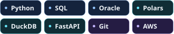

<h1 align="center">Hi, I'm Syazwan 👋</h1>

<strong>Software Engineer | Data Engineering Enthusiast</strong>

  

Software engineer based in Malaysia. I work with Python and SQL in data engineering and enjoy building backend tools, improving data pipelines, and contributing to open source.

## Tech stack

**Currently learning** · Apache Spark, Apache Airflow, and Databricks

## GitHub activity

  
  

Top Languages currently has no eligible public repository data. See Tech stack for the tools I use.

  

**Connect** · [@Wannn-Dev on GitHub](https://github.com/Wannn-Dev) · [Contribution activity](https://github.com/Wannn-Dev#js-contribution-activity)
